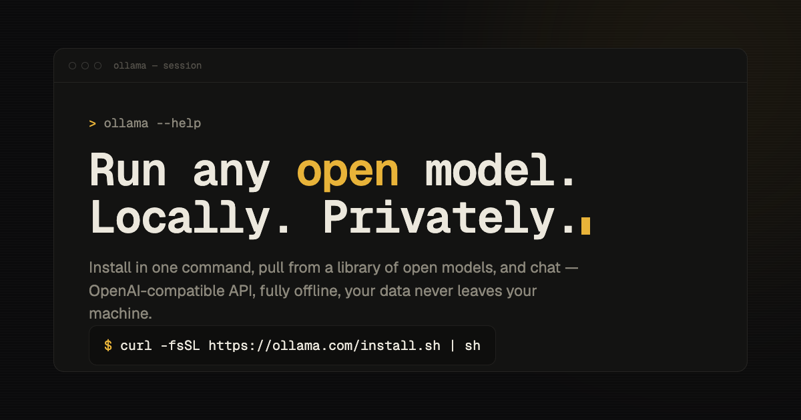

# Ollama — concept redesign

A concept redesign of [Ollama](https://ollama.com)'s landing page, art-directed
around a **"Living Terminal"** idea: the whole page behaves like one calm,
running shell session.

**Live:** https://vitaniko91-lang.github.io/ollama-redesign/

> ⚠️ Concept redesign — **not affiliated with Ollama**. Built as a portfolio
> piece to explore an alternative art direction, not an official product page.



## Why

The original landing leans on a familiar dev-tool template: it never really
**showcases the models** you can actually run, the primary CTA is soft, and the
visual language is flat. This redesign answers those three gaps:

- **Model showcase** — a dedicated, scannable Models section instead of burying
  the library a click away.
- **A confident CTA** — install is foregrounded as a single copy-able command
  plus a clear Download path.
- **A point of view, not a template** — a bespoke amber-on-charcoal terminal
  aesthetic in Geist Mono, set against an ambient **Token Stream Field**
  background (tokens drift past like a model decoding in the background), with a
  `⌘K` command palette so the page itself feels like a CLI you can drive.

## Tech stack

- **React + TypeScript**
- **Vite** (build/dev)
- **Tailwind CSS** (design tokens + styling)
- **motion** (scroll reveals, stream typing)
- **cmdk** (the `⌘K` command palette)
- **@iconify/react** (icons)
- **Vitest + Testing Library** (component tests)

## Run locally

```bash
npm install
npm run dev      # start the dev server (Vite)
```

Other scripts:

```bash
npm run build    # type-check + production build → dist/
npm run preview  # preview the production build
npm run test     # run the Vitest suite
npm run lint     # oxlint
```

## Deploy

Pushing to `main` triggers `.github/workflows/deploy.yml`, which builds with
Node 20 and publishes `dist/` to **GitHub Pages** via the official
`actions/deploy-pages` flow. Vite's `base` is set to `'./'` so the single-page
app resolves its hashed assets from the `/ollama-redesign/` project subpath.

---

Designed & built by Vitalina Nikulina. Concept work — not affiliated with Ollama.
